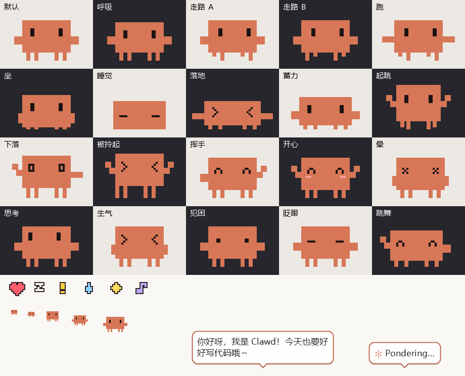

# Clawd 桌宠

Claude Code 的吉祥物 **Clawd** 搬到你的 Windows 桌面上：像素风、会走路、会说话，还能站在窗口顶上搭顺风车。

**原始桌宠源码由 Claude（Anthropic）编写。** 贡献说明见 [AUTHORS.md](AUTHORS.md)。



```
 ▐▛███▜▌
▝▜█████▛▘
  ▘▘ ▝▝
```

## 运行

从 [Releases](https://github.com/Starverse032/ClawdPet/releases) 下载 Windows 压缩包并解压。
从 GitHub 下载的源码包需要先按下方说明编译。

双击 `ClawdPet.exe` 即可。Clawd 会从屏幕上方掉下来，落在任务栏上跟你打招呼。
不需要安装任何东西（使用 Windows 自带的 .NET Framework 4.x）。

托盘区会出现一个 Clawd 小图标：右键打开菜单，双击把所有 Clawd 叫回当前屏幕。
再次双击 `ClawdPet.exe` 会**召唤一只小伙伴**（最多 8 只）。

## 互动

| 操作 | 效果 |
| --- | --- |
| 左键单击 | 开心地蹦一下，冒爱心 |
| 连续快速点 4 下 | 生气 “别戳啦！” |
| 鼠标在它身上来回蹭 | 摸摸头，脸红 + 爱心 |
| 按住拖动 | 拎起来（腿会晃）；松手可以**扔出去**，撞墙会弹 |
| 拖着来回猛甩 | 甩晕，落地后冒星星 |
| 右键 | 菜单：说句话 / 跳一下 / 跳个舞 / 想一想 / 睡一觉 / 各种设置（关闭菜单后焦点会还给你原来的窗口） |

只有 Clawd 本体接收鼠标；对话气泡、爱心、阴影都是“穿透”的，不会挡住下面窗口的点击。

## 它自己会做的事

- 散步、跑步、东张西望、坐下、伸懒腰、跳一跳、挥手、跳舞
- **在窗口上行走**：掉落时会落在窗口顶边上，偶尔还会主动跳上附近的窗口；
  你拖动那个窗口，它会跟着一起走；窗口被关掉、最小化、最大化或被挡住时它会掉下来
- **避让底部 MyDockFinder Dock**：贴近实际图标或栏体上沿停住，不预留透明放大区域；走出 Dock 左右边缘或 Dock 隐藏后自然落回屏幕底部。关闭“在窗口上行走”时也会避让。
- 眼睛跟着鼠标转，会眨眼；很久没人理会犯困，然后睡着（Zzz）
- 像 Claude Code 一样“思考”：`✻ Pondering…`、`Clauding…`、`Noodling…`
- 按时间打招呼，偶尔碎碎念
- **休息提醒**：连续使用电脑 45 分钟提醒你休息、喝水（离开键盘鼠标超过 5 分钟、锁屏都算休息过，会重新计时）
- 多只 Clawd 碰到一起会互相打招呼
- 全屏看视频 / 打游戏 / 放 PPT 时自动隐藏（每块屏幕单独判断，副屏全屏也能识别）
- 不抢焦点：点它、拖它都不会让你正在打字的窗口失去焦点；也不会盖住别的程序的右键菜单和输入法候选框

## 设置（右键菜单）

- **跟随鼠标**：Clawd 会追着鼠标走
- **在窗口上行走**：关掉后只在任务栏上活动
- **安静模式**：不主动说话（菜单里点“说句话”仍然会说）
- **休息提醒**、**全屏时自动隐藏**
- **大小**：小 / 中 / 大 / 特大（会随显示器缩放自动调整，保持像素清晰）
- **开机自动启动**：写入当前用户的 `HKCU\...\Run`，取消勾选即删除（如果在任务管理器“启动”页里禁用过，重新勾选会解除禁用）

设置保存在 `%APPDATA%\ClawdPet\settings.ini`，出错日志在同目录的 `error.log`。

## 接入 Claude Code

在本文件夹打开 PowerShell，执行一次：

```powershell
powershell -NoProfile -ExecutionPolicy Bypass -File .\Connect-ClaudeCode.ps1
```

脚本将 10 个状态 Hooks 合并到当前用户的 `%USERPROFILE%\.claude\settings.json`
（设置了 `CLAUDE_CONFIG_DIR` 时使用该目录），自动备份原文件，保留已有设置和 Hooks。
适用于本机 Claude Code 终端、VS Code 扩展，以及 **Claude Desktop 的 Code 页（本地会话）**。
已验证 VS Code 引擎 2.1.301 和 Claude Desktop 自带引擎 2.1.304 的真实会话开始/结束 Hooks。
Claude Desktop 的 Code 页共用此用户配置，无需再次安装；普通 Chat 页使用下方的 MCP 接口。
重新打开一个 Claude Code 会话后使用。云端/WSL 中运行的 Claude Code 无法直接调用这个 Windows exe。

| Claude Code 状态 | 桌宠反应 |
| --- | --- |
| 开始会话 | 打招呼，并自动启动桌宠（不增加小伙伴） |
| 发送提示 / 思考 | 思考姿势和旋转气泡 |
| 读取 / 搜索 / 编辑 / 执行工具 | 显示对应的简短动作说明 |
| 请求权限 / 提出问题 | 提示需要你确认；由你在 Claude Code 中操作 |
| 工具失败 | 提示工具未成功，继续跟踪后续状态 |
| 完成回复 | 开心表情和爱心 |
| API 错误 / 会话结束 | 显示错误提醒或告别 |

多个会话同时运行时，优先显示等待你确认的会话，其次显示仍在工作的会话。
一只主桌宠显示状态，小伙伴继续自由活动。拖拽、全屏隐藏和安静模式仍然有效。
右键可切换 **AI 联动（Claude / ChatGPT）**；托盘提示和菜单中会显示当前状态。
若关闭桌宠，下次新会话或发送提示时会重新启动；要完全解除自动启动和联动，可卸载 Hooks。

连接仅使用本地 `%APPDATA%\ClawdPet\claude-code` 目录：短暂保存事件类型、会话标识和工具名，
桌宠读取后立即删除事件文件；`status.json` 保留不含会话标识的最新状态，方便排查。
不保存提示词、回复、文件内容、命令参数或密钥，不调用额外模型，不改变 Claude 的权限决定。
30 分钟没有新事件的状态会自动过期，避免意外退出后一直显示忙碌。

解除连接（保留其他 Hooks）：

```powershell
powershell -NoProfile -ExecutionPolicy Bypass -File .\Connect-ClaudeCode.ps1 -Remove
```

如果移动本文件夹，先在原位置解除连接，再在新位置运行接入脚本。
Hook 接口参考：[Claude Code 官方文档](https://code.claude.com/docs/en/hooks)。

## Claude Desktop 普通聊天（Chat）

执行一次（安装脚本会备份配置，保留其他 MCP 服务器和设置）：

```powershell
powershell -NoProfile -ExecutionPolicy Bypass -File .\Connect-ClaudeDesktop.ps1
```

重新启动 Claude Desktop，在聊天的工具/连接器列表中找到 **clawdpet**。它提供：

- `clawdpet_act`：挥手、跳舞、开心、思考、等待、睡觉、错误提示、恢复自由活动；可附带最多 80 字符的气泡。
- `clawdpet_status`：读取桌宠运行情况和当前状态。

可以直接对 Claude 说：**“用 clawdpet 让桌宠跳个舞，并说：你好！”**
若 Claude Desktop 首次调用时询问工具权限，在应用内自行确认即可。

希望普通聊天显示任务进度时，可以发送：

> 本次对话请使用 clawdpet 工具显示任务状态。开始处理较长任务时设为 thinking，
> 需要我回答时设为 waiting，完成时设为 happy，最后用 idle 恢复自由活动。
> 气泡只写简短提示，不复制对话内容或敏感信息。

**Chat 通过 Claude 调用工具控制动作，不会自动监测每轮生成或回复完成。**
是否调用由 Claude 决定；普通 Chat 没有接入 Code 的生命周期 Hooks。
动作默认持续 8 秒，thinking/waiting 默认 30 秒，可指定 1–120 秒；到期自动恢复。
同一个 MCP 连接中的聊天共享最近一次动作。Code 的工作/等待权限状态优先，Chat 的 idle 不会清除 Code 任务。

MCP 服务器由同一个 `ClawdPet.exe --desktop-mcp` 提供，无需 Node、Python、API Key 或额外网络服务。
只允许控制桌宠和读取桌宠状态，不能运行命令或读取任意文件。自定义气泡会短暂保存在本地事件和状态文件中。
桌宠关闭时，调用动作会重新启动它；仅打开 Desktop、握手或读取状态不会启动桌宠。

默认修改当前 Desktop 模式的配置：标准模式为 `%APPDATA%\Claude\claude_desktop_config.json`，
第三方提供商模式为 `%LOCALAPPDATA%\Claude-3p\claude_desktop_config.json`。
可通过 `-ConfigPath` 明确指定其他配置路径。

解除普通 Chat 的接入（不影响 Code Hooks）：

```powershell
powershell -NoProfile -ExecutionPolicy Bypass -File .\Connect-ClaudeDesktop.ps1 -Remove
```

配置方法参考：[MCP 官方 Claude Desktop 文档](https://modelcontextprotocol.io/docs/develop/connect-local-servers)。

## 接入当前 Codex 应用

在本文件夹执行一次（需要本机已有 `codex` 命令）：

```powershell
powershell -NoProfile -ExecutionPolicy Bypass -File .\Connect-Codex.ps1
```

脚本用 Codex 自带的配置工具注册 `clawdpet`，命令为本目录的
`ClawdPet.exe --codex-mcp`。安装前备份 `%USERPROFILE%\.codex\config.toml`
（设置了 `CODEX_HOME` 时使用该目录），保留原有服务器、模型和权限设置。
重复执行不会重复安装；遇到其他同名服务器会停止，避免覆盖。

在 Codex 的 **设置 → MCP 服务器** 中确认 `clawdpet` 已启用。
重新加载 MCP 或新开聊天后，可直接说：

> 用 clawdpet 让桌宠跳个舞，并说：Codex 已连接！

工具与 Claude Desktop 相同：`clawdpet_act` 控制 8 种动作，`clawdpet_status` 查询运行状态。
默认气泡标注 **ChatGPT**；Codex 和 Claude 的连接各自管理动作，结束一个连接不会清除另一个连接的动作。
自动对话状态和 Claude Code 等待权限、执行任务有较高显示优先级。

需要任务进度联动时，可以说：

> 本次聊天请用 clawdpet 显示任务状态：开始时 thinking，需要我回答时 waiting，
> 完成时 happy。气泡只写简短状态。长任务期间适时更新；空闲时用 idle 恢复自由活动。

以上 MCP 模式由 Codex **调用工具** 驱动；每轮自动联动请启用下方的生命周期 Hooks。
无需 API Key，不发起额外模型请求，不读取聊天记录。动作时长和本地存储方式与上方 Desktop MCP 一致。
本节针对当前电脑的 Codex 本地聊天；ChatGPT 网页和云端会话不能直接运行此本地 exe。

解除 Codex 接入（保留 Claude 接入）：

```powershell
powershell -NoProfile -ExecutionPolicy Bypass -File .\Connect-Codex.ps1 -Remove
```

参考：[OpenAI 官方 MCP 配置文档](https://learn.chatgpt.com/docs/extend/mcp)。

### 每轮对话自动联动（ChatGPT）

本机 Codex 支持通过官方生命周期 Hooks 自动通知桌宠，无需每轮要求模型调用工具：

```powershell
powershell -NoProfile -ExecutionPolicy Bypass -File .\Connect-CodexHooks.ps1
```

脚本将 10 个事件合并到 `%USERPROFILE%\.codex\hooks.json`（或 `CODEX_HOME`），
备份已有文件、保留其他 Hooks，不修改模型和权限配置。

**安装后还需一次 Codex 信任审核。** 在 PowerShell 运行 `codex`，进入后输入 `/hooks`，
审阅并信任命令指向本目录 `Invoke-CodexHook.ps1` 的 10 个 Hooks。
它们对应 SessionStart、UserPromptSubmit、PreToolUse、PermissionRequest、PostToolUse、
PreCompact、PostCompact、Stop、Interrupt、SessionEnd。
重新打开或恢复本机 Codex 聊天后使用。新建或修改的 Hooks 在信任前会被 Codex 跳过。
本项目安装器不会改写信任记录或启用绕过审核选项。

| 对话状态 | 桌宠表现 |
| --- | --- |
| 发送消息、思考、使用工具或整理上下文 | 保持“想一想”姿势和转圈；每 5 秒轮换原有 `Lines.Verbs` 文案，例如 **ChatGPT · Pondering…** |
| 等待确认或回答 | **跳一下**，落地后等待，气泡注明 **ChatGPT · 等你确认～**；同一请求不会不停跳 |
| 回复完成 | **跳个舞**并冒音符，显示 **ChatGPT · 回复完成啦！**；约 8 秒后恢复自由活动 |
| 用户中断 | 显示 **ChatGPT · 本轮已停止**，结束忙碌状态 |
| 会话结束 | 显示 **ChatGPT · 会话已结束～**，然后恢复自由活动 |

全屏隐藏、拖拽、安静模式和“AI 联动”总开关继续生效。
多个会话中先显示等待用户的会话，其次显示工作的会话；旧轮次完成事件不会清除新轮次状态。
MCP 的 idle 只解除手动动作，不清除自动监听到的任务。
超过 30 分钟没有新事件的状态会过期，避免意外退出后一直忙碌。

Hooks 只短暂保存事件类型、会话/轮次标识、工具名等状态信息，不保存提示词、回复、工具参数或结果，
没有额外模型调用。为处理桌面应用偶尔漏发 `Stop` 的情况，桌宠会在后台检查已联动轮次的本地
`CODEX_HOME/sessions`（默认 `%USERPROFILE%\.codex\sessions`）记录尾部，只根据同一会话、同一轮次的
`task_complete` 元数据结束思考；不保存或发送聊天正文。检测约每秒一次，不会因短暂没有输出而提前结束。
此补偿依赖本地 Codex 记录格式；没有本地记录的云端会话仍依赖 Hooks。
每个 Hook 只写本地状态，出错也返回成功且不输出内容，
不会替你批准权限、修改提示词或要求模型继续工作。
此模式针对本机 Codex 生命周期，不适用于 ChatGPT 网页或云端编排会话。

解除自动监听（保留 MCP 手动动作和 Claude 接入）：

```powershell
powershell -NoProfile -ExecutionPolicy Bypass -File .\Connect-CodexHooks.ps1 -Remove
```

官方说明：[Codex Hooks 与信任审核](https://learn.chatgpt.com/docs/hooks)。

## 自己编译

```bat
build.bat
```

用的是 Windows 自带的 `C:\Windows\Microsoft.NET\Framework64\v4.0.30319\csc.exe`（C# 5），
第一次编译会让程序自己画出 `clawd.ico` 再嵌进 exe。编译前请先从托盘退出正在运行的 Clawd
（否则 exe 被占用，编译会失败；双击 build.bat 时窗口会停住让你看到结果）。

桌宠运行中也可以编译到其他目录：

```bat
build.bat /nopause dist\ClawdPet.exe
```

编译参数和源码列表统一维护在 `ClawdPet.rsp`。

## 测试

```powershell
powershell -NoProfile -ExecutionPolicy Bypass -File .\tests\Run-Tests.ps1
```

测试会自动编译到 `work/` 下的独立目录，检查 Hook 输入、会话状态、完成事件补偿、Dock 边界与下落、
安装器和两种 MCP 接口。不会修改用户的 Claude/Codex 配置或启动额外桌宠。
GitHub Actions 在 Windows 上执行相同测试，并提供包含程序和接入脚本的 `ClawdPet-Windows` 构建包。

调试小工具：

- `ClawdPet.exe --sheet preview.png`：导出所有姿势、表情、特效和图标的预览图
- 设置环境变量 `CLAWD_DUMP=某个目录` 后运行：每 0.5 秒把实际渲染的画面存成 PNG（前 40 帧）

## 文件

| 文件 | 说明 |
| --- | --- |
| `ClawdPet.cs` | 桌宠源码（渲染、物理、状态机、窗口扫描、托盘、菜单） |
| `ClaudeLink.cs` | Claude Code 事件接收、并发会话状态和本地诊断 |
| `Connect-ClaudeCode.ps1` | 接入 / 解除 Hooks，自动备份和保留原配置 |
| `DesktopMcp.cs` | 普通 Chat 使用的本地 MCP 工具接口 |
| `Connect-ClaudeDesktop.ps1` | 接入 / 解除 Desktop MCP，自动备份和保留原配置 |
| `Connect-Codex.ps1` | 接入 / 解除 Codex MCP，自动备份和保留原配置 |
| `CodexHooks.cs` | 每轮 ChatGPT 生命周期事件接收、轮次隔离、完成事件补偿与显示文案 |
| `Connect-CodexHooks.ps1` | 安装 / 解除每轮自动监听，保留其他 Hooks |
| `Invoke-CodexHook.ps1` | Windows stdin 转发，无日志正文、无权限决定 |
| `app.manifest` | 每显示器 DPI 感知、Win10/11 兼容声明 |
| `build.bat` | 一键编译 |
| `ClawdPet.rsp` | 应用与测试共用的编译参数和源码列表 |
| `tests/Run-Tests.ps1` | 一键运行隔离回归测试 |
| `clawd.ico` | 程序生成的图标 |
| `ClawdPet.exe` | 编译好的程序 |

## 贡献者

- **Claude（Anthropic）**：桌宠原始源码的编写者。
- **[Starverse032](https://github.com/Starverse032)**：项目维护、需求设计与使用反馈。
- **Codex（OpenAI）**：Claude/Codex 联动接入、MyDockFinder 适配，以及本次代码精简、测试与 GitHub 发布整理。

完整说明见 [AUTHORS.md](AUTHORS.md)。Clawd 形象归 Anthropic 所有；本项目是粉丝自制的桌面小玩具，并非 Anthropic 或 OpenAI 官方产品。
